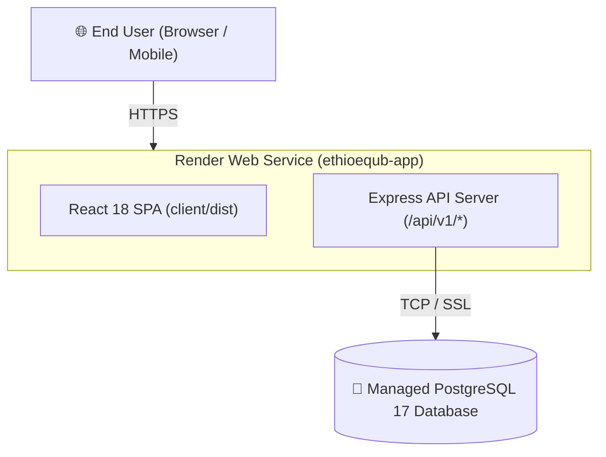

# EthioEqub Digital Management System (ዕቁብ)

[](https://ethioequb-digital-management-system.onrender.com)
[](https://ethioequb-digital-management-system.onrender.com/api/health)
[](https://github.com/wagnew-nigussie)
[](https://www.typescriptlang.org/)
[](https://reactjs.org/)
[](https://www.postgresql.org/)

---

### 🚀 Public Live Deployment

The system is fully deployed in the cloud and open for public testing:

> 🌐 **Live Web Application:** **[https://ethioequb-digital-management-system.onrender.com](https://ethioequb-digital-management-system.onrender.com)**  
> 🏥 **Live Health Endpoint:** **[https://ethioequb-digital-management-system.onrender.com/api/health](https://ethioequb-digital-management-system.onrender.com/api/health)**

#### 🔑 Instant One-Click Demo Credentials
You can explore the live system immediately using any of these pre-seeded accounts:

| Role in Bole Equb | Full Name | Email Address | Password | Permissions & Capabilities |
|:---|:---|:---|:---|:---|
| **Group Owner** | **Wagnew Nigussie** | `wagnewnigussie569@gmail.com` | `password123` | Full ownership, group management, cycle scheduling |
| **Group Treasurer** | **Tigist Haile** | `tigist@gmail.com` | `password123` | Record contributions, receipts, dual-control payout authorization (Approver 1) |
| **Member** | **Chala Tadesse** | `chala@gmail.com` | `password123` | View personal payment history, cycles, and lottery draw rank |
| **Member** | **Marta Bekele** | `marta@gmail.com` | `password123` | Active member; cycle 3 payment pending |
| **Platform Admin** | **System Admin** | `admin@ethioequb.com` | `password123` | Complete platform oversight, security audit log inspector |

*Note: The login page includes quick-fill buttons to sign in with any demo user in 1 click!*

---

## 1. System Overview

Traditional Equb associations in Ethiopia pool hundreds of millions of Birr annually. However, they rely heavily on informal notebooks, physical receipts, and verbal agreements, leading to record loss, payment disputes, and unilateral control.

**EthioEqub** digitizes and governs Equb operations end-to-end:
- **Zero IEEE-754 Precision Loss:** All financial calculations strictly executed as 64-bit integer minor units (santim / cents). 1 Birr = 100 santim.
- **Ledger Immutability (Zero In-Place Deletions):** Corrections are recorded exclusively through signed differential adjustment rows (`Adjustment`) linked to the parent transaction.
- **Dual-Control Payout Governance:** Disbursing pooled funds requires independent authorization from two distinct accounts (`Approver 1 != Approver 2`), with configurable single-approval for small family circles (< 5 members).
- **Duplicate Reference Prevention:** Unique composite database constraints block accidental duplicate receipt submissions on Telebirr, CBE Birr, and Bank transfers.
- **Tamper-Evident Audit Trail:** Every mutating action captures actor identity, timestamp, IP address, and JSON state diffs.
- **Exportable Ledgers:** Sanitized CSV transaction ledgers protected against formula-injection attacks.
- **Ethiopian Context Aware:** Features live Addis Ababa time ticker, Ethiopian calendar indicators (*Tikimt 2017*), printable digital receipts, and Ethiopian Civil Code Articles 3040–3052 reference baseline.

---

## 2. Monorepo Project Architecture

```text
EthioEqub Digital Management System/
├── client/                     # Modern React 18 SPA (Vite + TailwindCSS)
│   ├── src/
│   │   ├── components/common/  # Navbar, Sidebar, Right Action Rail, Modals, Footer
│   │   ├── context/            # AuthContext, UIContext (Universal Search, Receipts)
│   │   ├── pages/              # Dashboard, Groups, Contributions, Payouts, Reports, Audit
│   │   ├── services/           # Typed API Client with session credentials
│   │   └── main.tsx            # App router & entry point
│   ├── index.html
│   ├── vite.config.ts          # Bundler & proxy configuration
│   └── tailwind.config.js      # Styling design system
│
├── server/                     # Backend REST API Server (Node.js + Express)
│   ├── prisma/
│   │   ├── schema.prisma       # 10 Relational entities matching PRTDD specification
│   │   └── seed.ts             # Seeder script
│   ├── src/
│   │   ├── config/             # PostgreSQL database connection singleton
│   │   ├── controllers/        # Auth, Group, Contribution, Payout, and Audit controllers
│   │   ├── middleware/         # Auth, RBAC group guards, error handler, rate limiter
│   │   ├── routes/             # REST endpoints mounted at /api/v1/*
│   │   ├── services/           # Business logic & seedService (auto-seeds cloud on boot)
│   │   └── utils/              # Standardized AppError hierarchy
│   ├── tests/                  # Vitest unit & integration test suite (100% passing)
│   └── tsconfig.json
│
├── shared/                     # Shared TypeScript Library (@ethioequb/shared)
│   ├── src/index.ts            # Domain enums, financial math utils, and Zod DTO schemas
│   └── tsconfig.json
│
├── docs/                       # Official Documentation Baseline
│   ├── EthioEqub_Digital_Management_System_PRTDD.pdf  # 50-Page Print-Ready PDF
│   └── EthioEqub_Digital_Management_System_PRTDD.html # Document HTML Source
│
├── render.yaml                 # Infrastructure-as-Code Blueprint for Render cloud
├── docker-compose.yml          # Container configuration for external PostgreSQL deployment
└── package.json                # Monorepo workspaces coordinator
```

---

## 3. Local Quick Start & Execution Guide

### 1. Start the PostgreSQL Database
```bash
./scripts/start_postgres.sh
```
*Output: `/tmp:5436 - accepting connections`*

### 2. Run the Development Servers
```bash
./scripts/start_dev.sh
```
Or run individually:
- **Backend API:** `npm run dev:server` (Listening at `http://localhost:5000`)
- **Frontend App:** `npm run dev:client` (Listening at `http://localhost:5173`)

### 3. Run Automated Tests
```bash
npm test
```
*Executes all 10 unit and integration tests across financial arithmetic, cycle schedule algorithms, and API endpoints.*

### 4. Build Full Monorepo for Production
```bash
npm run build
```
*Compiles `@ethioequb/shared`, builds backend `server`, and generates optimized production assets in `client/dist/`.*

---

## 4. Cloud Deployment Architecture

The application is deployed on **Render** as a unified full-stack web service backed by a managed **PostgreSQL 17** database:



- **Zero-Config Auto-Migration:** On container boot, `prisma db push` syncs all tables automatically.
- **Auto-Seeding:** If the cloud database is blank, `seedService` provisions authentic demo data without requiring shell access.
- **Single-Port Architecture:** Express statically hosts `client/dist/` in production and routes `/api/*` requests internally, eliminating cross-origin CORS latency.

---

## 5. Security & Financial Integrity Enforcements

- **BOLA / IDOR Defense:** `requireGroupRole` middleware verifies that the authenticated user holds an active membership and role in the requested group before fulfilling requests.
- **Anti-XSS Session Handling:** Authentication tokens are stored in `HttpOnly`, `Secure`, `SameSite=Lax` cookies inaccessible to JavaScript.
- **Double Approver Constraint:** The system strictly rejects attempts where `Approver 1 ID == Approver 2 ID`.
- **CSV Formula Injection Sanitization:** Cells starting with `=, +, -, @` are prepended with a single quote.
- **ACID Transaction Boundaries:** Multi-record financial mutations are wrapped in `prisma.$transaction`.

---

## 6. Official Documentation

The complete **Project Requirements and Technical Design Document (PRTDD v1.1)** is available at:
- **PDF File:** [`docs/EthioEqub_Digital_Management_System_PRTDD.pdf`](./docs/EthioEqub_Digital_Management_System_PRTDD.pdf)
- **HTML Source:** [`docs/EthioEqub_Digital_Management_System_PRTDD.html`](./docs/EthioEqub_Digital_Management_System_PRTDD.html)

---

## 7. Author & Project Ownership

- **Lead Software Engineer & System Architect:** Wagnew Nigussie
- **Email:** `wagnewnigussie569@gmail.com`
- **GitHub Profile:** [@wagnew-nigussie](https://github.com/wagnew-nigussie)
- **Project Repository:** [EthioEqub-Digital-Management-System](https://github.com/wagnew-nigussie/EthioEqub-Digital-Management-System)
- **Live Demo:** [https://ethioequb-digital-management-system.onrender.com](https://ethioequb-digital-management-system.onrender.com)
